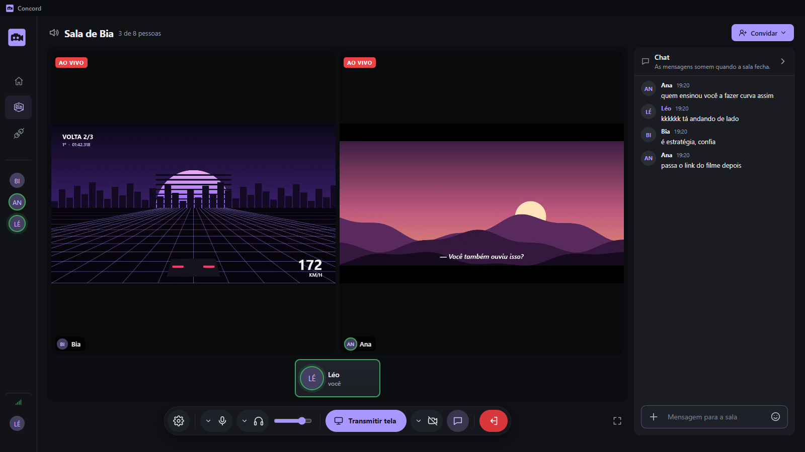

  

<h1 align="center">Concord</h1>

Call de voz e compartilhamento de tela com os amigos, numa sala só de vocês.

  <a href="https://github.com/MiharaxD/concord/releases/latest"><strong>Baixar para Windows</strong></a>

  

Até **8 pessoas** por sala numa **call de voz**, com várias telas ao vivo ao mesmo tempo, câmera e chat. Dá pra usar só pra conversar, sem ninguém transmitir nada. Sem conta, sem servidor e sem nada salvo.

## Como usar

1. **Instale e escolha seu nome.** Foto e banner são opcionais.
2. **Crie uma sala** e clique em **Copiar link**.
3. Mande o link pros amigos. Quem abre já cai na sala, com o microfone ligado, como numa call.
4. Quer mostrar algo? Escolha a tela ou janela e clique em **Compartilhar tela**.

Clique numa transmissão pra deixar ela grande; clique de novo pra voltar à grade.

**Parar de transmitir mantém a sala aberta. Fechar o Concord de quem criou a sala fecha a sala e o link.**

## Como a conexão funciona

A sala roda no PC de quem criou. Não existe servidor do Concord no meio.

- **O link é a chave.** Cada sala gera uma chave aleatória que vai dentro do link. Só entra quem tem o link.
- **Os PCs se encontram sozinhos.** O Concord usa servidores públicos só pra apresentar um PC ao outro, e essa conversa vai cifrada com a chave da sala. Depois disso a conexão é direta entre vocês.
- **Sem configurar nada.** Nada de abrir porta no roteador, IP ou cadastro. Se a rede de alguém bloquear a conexão direta, o Concord monta um caminho alternativo pela Cloudflare só pra essa pessoa.
- **Você decide o que aparece.** Tela e câmera só começam quando você escolhe. O microfone abre ao entrar na sala e dá pra mutar a qualquer momento.

## Segurança e privacidade

- **Sem conta e sem histórico.** Chat, imagens e arquivos ficam só na memória e somem quando a sala fecha.
- **Conexão cifrada.** Vídeo, voz e chat viajam criptografados direto entre os participantes (WebRTC). No caminho alternativo pela Cloudflare, o tráfego passa por ela.
- **Link vazou?** Em **Convidar → Fechar acesso**, o link para de funcionar e ninguém novo entra. Depois é só gerar um convite novo.
- **Discord é opcional.** Se ligar a conta, o acesso fica guardado criptografado no seu PC e serve só pra importar o perfil e mandar convites.

## Recursos

| Recurso | O que oferece |
| --- | --- |
| Call de voz | Microfone abre ao entrar na sala; mute, ensurdecer, troca de microfone e volume por pessoa |
| Transmissões | Várias telas ao mesmo tempo, grade adaptável, foco e tela cheia |
| Câmera | Sozinha ou junto com a tela, no canto, em tela cheia ou em quadro separado |
| Chat | Texto, imagens, vídeos e arquivos de qualquer tamanho; some quando a sala fecha |
| Qualidade | 720p, 1080p, 1440p ou 4K, a 30 ou 60 FPS; bitrate automático ou de 1 a 60 Mbps |
| Áudio | Som só do jogo/app ou do computador inteiro, escolhido sozinho |
| Perfil | Nome, foto e banner salvos no seu PC |
| Discord | Opcional: importa o perfil e convida amigos por mensagem direta |
| Atualizações | Baixam sozinhas; é só clicar em **Reiniciar e atualizar** |

## Atalhos

| Tecla | Ação |
| --- | --- |
| **M** | Silenciar ou ativar o som da sala |
| **F** | Tela cheia |
| **Esc** | Voltar à grade ou fechar um pop-up |

## Requisitos

- **Windows 10 ou 11, 64 bits.** O instalador já traz tudo.
- Som só de um app exige Windows 10 versão 2004 ou mais recente. Em Windows mais antigo a transmissão funciona com o som do computador, e o app avisa.
- Mais gente transmitindo pede mais internet e processamento de quem está na sala.
- Convites pelo Discord têm limite de 100 mensagens a cada 2 horas para o app inteiro.

## Documentação

- Termos de uso (link em breve)
- Política de privacidade (link em breve)

Desenvolvido por Yuri Mihara

